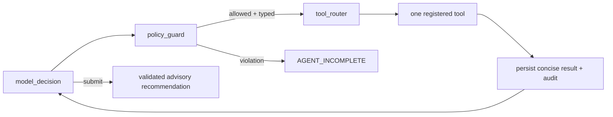

# Agent Policy

## Authority

The Document Intake Resolution Agent produces evidence-backed AP-invoice candidates and an advisory
recommendation. It cannot approve, reject authoritatively, mutate document/graph status, create an
integration event, access arbitrary SQL/files/URLs, or bypass deterministic validation.

## Guarded dispatch

Before execution the guard verifies the tool is one of the nine constitution tools, Pydantic input
validation succeeds, tenant/document/agent identities equal the graph context, no restricted
operation is encoded, prerequisites hold, counters remain within policy, and submission has the
required candidate/classification evidence. The router treats model output as data only.

## Limits and failures

Limits are 10 total calls, 3 extraction attempts, 2 supplier lookups, 2 PO lookups, serial tools,
per-model and per-tool timeouts, and a total deadline. Provider unavailable/timeout, malformed
structured output, tool timeout, policy rejection, and limit exhaustion produce versioned reason
codes and an incomplete recommendation. Transient database/storage failures use bounded graph node
retry; authorization, schema, policy, and permanent configuration failures do not retry.

## Persistence

Persist requested tool, minimized validated arguments, stable operation key, bounded result summary,
duration, provider/model and usage metadata, reason codes, and recommendation. Never persist private
reasoning, raw provider payloads, unrestricted paths, secrets, or document contents. Replayed nodes
reuse operation keys and cannot duplicate extraction, lookup, recommendation, or audit effects.
