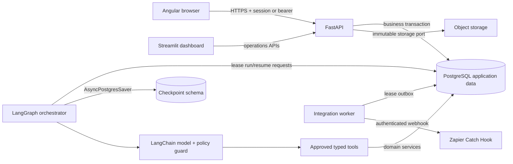
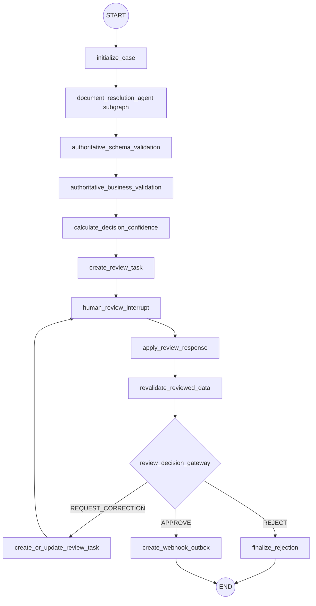
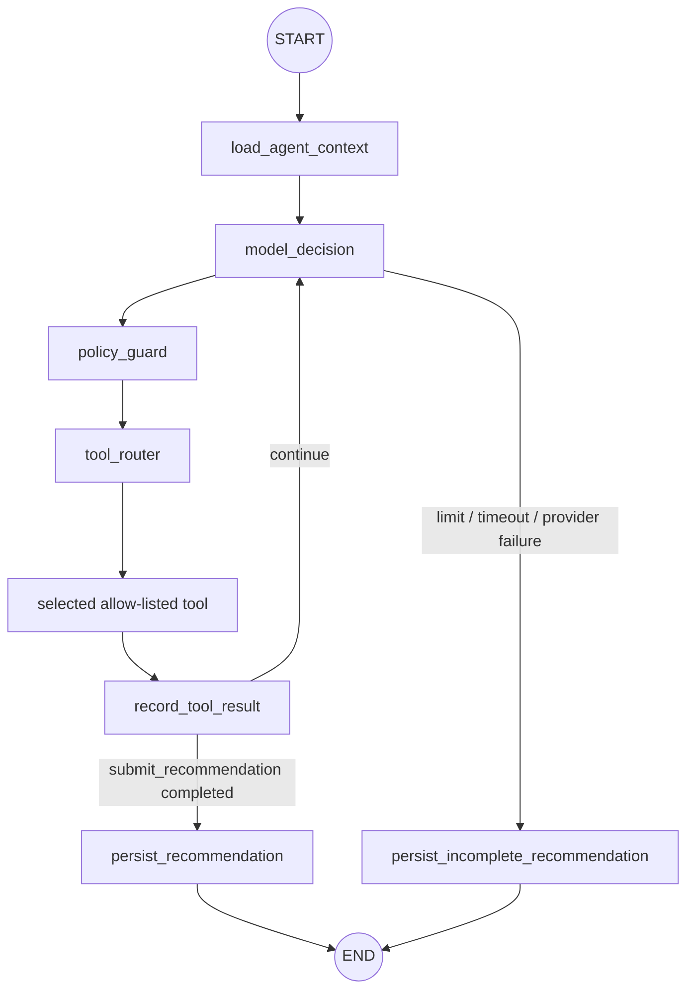

# Architecture Overview

## System shape

The platform separates HTTP transactions, durable orchestration, model/tool decisions, business
authority, and external delivery. PostgreSQL is the rendezvous point; no correctness path depends on
a web process staying alive.

The API and orchestrator use distinct processes and least-privilege identities. The dashboard cannot
write application tables. Browsers never connect to graph/checkpoint, database, model, storage, or
integration endpoints directly.

In the local profile, FastAPI may issue opaque, expiring, process-local role sessions. Angular uses
the HttpOnly cookie through its same-origin proxy, while Streamlit keeps its cookie in a server-side
HTTP client. Configured bearer tokens remain available to non-browser clients and are never
returned to either UI. Production rejects both development authentication mechanisms.

## Transaction boundaries

### Intake

FastAPI streams and validates the PDF into staged storage. One PostgreSQL transaction writes tenant-
scoped metadata, version/status history, idempotency response, append-only audit events, and a
`graph_run_requests` record. Commit publishes the immutable object; compensation removes an
unreferenced object on database failure. No graph invocation occurs in this transaction.

### Run and resume

The orchestrator atomically leases due requests, commits the lease, then invokes the graph using the
record's unique `thread_id`. Checkpoints persist after graph steps. The orchestrator projects
business milestones to application tables and audit events through idempotent domain commands.
Checkpoint state is operational recovery data, not the business system of record.

FastAPI writes validated human decisions and a graph-resume request in one transaction. The
orchestrator later leases that request and resumes the same thread with `Command(resume=...)`.

### Approval and delivery

An approval domain transaction writes the authoritative approved state, approval audit event, and
unique outbox event. The integration worker performs HTTP only after leasing a committed event. A
delivery ledger records attempts and responses in bounded, sanitized form. Unique event keys and
receiver idempotency keys prevent graph replay from duplicating business effects.

## Parent and agent graphs

The agent subgraph loops between a model-decision node, policy guard, and one approved tool at a
time. Counters and deadlines determine whether it may continue. `submit_recommendation` ends the
subgraph only after contract validation. Any controlled failure produces `AGENT_INCOMPLETE`; the
parent still validates what exists and creates review.

## Source-of-truth boundaries

| Concern | Source of truth |
|---|---|
| Original bytes and object hash | Immutable storage plus `stored_objects` |
| Document status and extracted fields | Application tables |
| Rule and confidence results | Versioned application records |
| Agent activity and recommendation | Agent-run/tool-call application records |
| Durable graph position | PostgreSQL LangGraph checkpoints |
| Review ownership and decision | Application review tables |
| Business audit | Append-only `audit_events` |
| Webhook intent and delivery | Outbox plus delivery ledger |

Graph state holds only identifiers and bounded working summaries. Full documents, credentials,
unrestricted paths, hook URLs, and raw provider bodies are excluded.

## Failure model

All consumers assume at-least-once execution. Database leases expire; retries are bounded and use
exponential backoff with jitter; terminal status and safe error codes are queryable. Node replay is
safe because state transitions, review-task creation, extraction attempts, recommendations, and
outbox events have stable idempotency keys. Model outage or malformed output degrades to human
review. Zapier outage never rolls back approval and eventually becomes dead-letter-visible.

## Deployment units

- `angular-web`: Angular static application
- `fastapi-api`: FastAPI HTTP service
- `langgraph-orchestrator`: LangGraph run/resume consumer
- `integration-worker`: outbox delivery consumer
- `streamlit-dashboard`: Streamlit read/command client over FastAPI
- `postgres`: application and checkpoint tables (one local-demo credential/namespace; production
  separation and least-privilege roles remain deployment hardening)
- `mock-zapier`: profile-scoped deterministic Catch Hook for local/test only

Local immutable storage is a named volume for the demo. Production can replace it through the
storage port without changing domain behavior.
