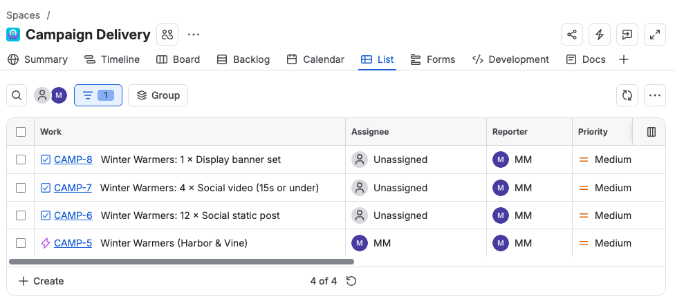

# From brief to booked work: what the intake demo shows

An overview of the business case. Engineers: start with the [README](../README.md).

## What this is

This demo is a document-intake platform: it turns the documents a business receives into checked, approved work in the tools its teams already use. An AI model reads each document, fixed business rules check it and send it to the right team, and a person approves before anything is created.

It handles four document types today, each with its own fields, rules, and queues on a shared core:

| Document | What the platform produces | Where it goes |
| --- | --- | --- |
| Agency campaign briefs | A work request with one task per deliverable | Jira (running end to end) |
| Supplier invoices | A checked bill | QuickBooks (bill prepared) |
| Insurance claim packets | A claim file routed to the right adjuster queue | Jira issue (prepared) |
| Customer-data onboarding requests | A field-mapping plan, with personal data screened out before the AI sees it | Jira (plan prepared) |

The rest of this overview follows one of them, campaign briefs, through the full loop.

## Campaign briefs today

Every new campaign starts as a brief from the client: a PDF form, a memo, a slide deck, or a long email thread. Before any creative or media work can begin, someone on the agency side has to read it, retype it into the project tool, and check it against the contract.

That hand-off is slow and easy to get wrong:

- **Re-keying.** Each deliverable, quantity, and due date is copied by hand into tasks.
- **Missing information.** Briefs arrive without a budget or a measurable goal, and the gap is found weeks later.
- **Changes buried in email.** A follow-up note moves the launch date or adds work, and the plan never reflects it.
- **Scope creep.** Requests for services the contract does not cover slip through without a change order.

## What the demo does

The demo takes a brief from upload to ready-to-work tasks in Jira, with a person approving in the middle. Five steps:

1. **Upload.** The brief is dropped in as a PDF, whatever its format.
2. **Read.** An AI model pulls out the work request: client, campaign, goal, budget, dates, and every deliverable. Each value points back to the page it came from.
3. **Check and route.** Fixed business rules compare the request with the client's contract and production lead times, then place it in a queue: ready for planning, needs client info, scope review, legal review, rush review, or traffic review.
4. **Review and approve.** A traffic or account manager sees the brief beside the extracted fields, fixes anything wrong, and approves. Incomplete briefs get a drafted list of questions for the client.
5. **Create the work.** On approval, Jira receives one epic for the campaign and one task per deliverable, with due dates, labels, and priority filled in.

## A worked example

**The routine case.** A coffee chain sends a one-page brief for its "Winter Warmers" campaign: 12 social posts, 4 short videos, and a set of display banners, launching December 1. The budget fits the contract and every deliverable has enough production time, so the brief lands in *ready for planning*. One approval later, Jira shows the campaign epic with three tasks, each due on the date the client asked for.

**The catch.** A second brief from the same client looks just as routine: launch January 5. But a follow-up email in the packet moves the launch to November 30. The system reads both, notices the conflict, and calculates that the video can no longer be produced in time. The brief goes to *rush review* with the two dates side by side, instead of quietly entering the plan with the wrong deadline.

All clients, briefs, and numbers in the demo are fictional.

## Why it can be trusted

The AI reads and proposes; it never decides. The design keeps three kinds of judgment apart:

| Who | Does what | Never does |
| --- | --- | --- |
| AI model | Reads the brief and fills in the fields, citing the page for each | Choose a queue, approve, or contact anyone |
| Business rules | Check budget, scope, lead times, legal flags, duplicates; pick the queue | Change what the brief says |
| People | Correct fields, approve or reject, send client questions | Get bypassed: nothing reaches Jira without an approval |

Every step is recorded, so anyone can see later why a brief went to a queue and who approved it. The same approval can't create work twice, even if a message is resent.

## What it means for the business

- **Less re-keying.** Deliverables, dates, and descriptions arrive in Jira already filled in.
- **Problems caught before work starts.** Missing budgets, unmeasurable goals, out-of-scope requests, and impossible deadlines are flagged at intake, not mid-production.
- **Clear ownership.** Each brief lands in the queue of the team that should look at it, with a service-level target for the first review.
- **Teams stay in their tools.** Planners work in Jira as they do today; the demo feeds it rather than replacing it.

The other three document types run through the same steps on the same core. Adding another one means adding its fields, rules, and queues, not rebuilding the system.

## Where it stands

The brief-to-Jira loop runs end to end today: a brief approved in the review screen becomes an epic and its tasks in a real Jira project, with no manual steps in between. The demo uses 20 fictional briefs that cover the common problems, from missing budgets to a pharma brief that needs legal review.
