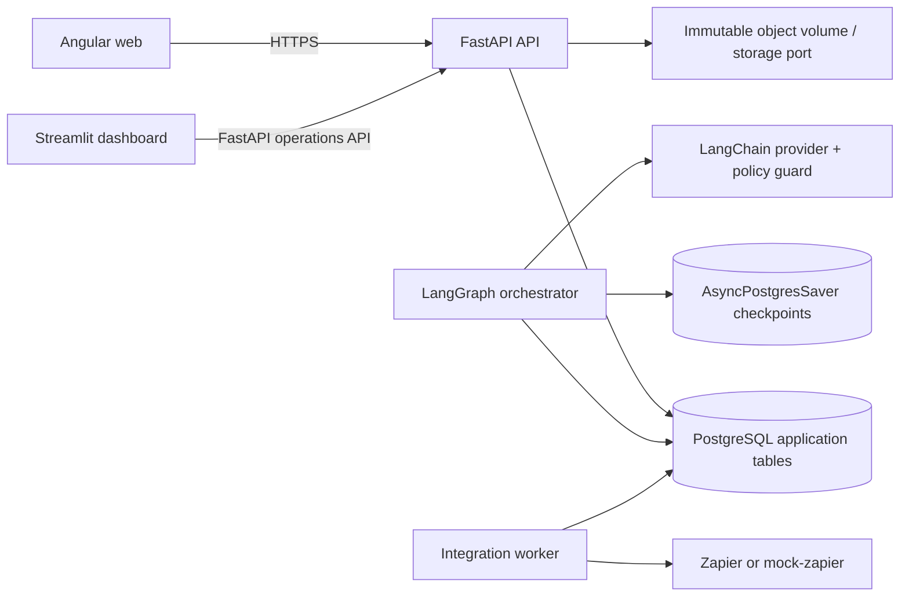
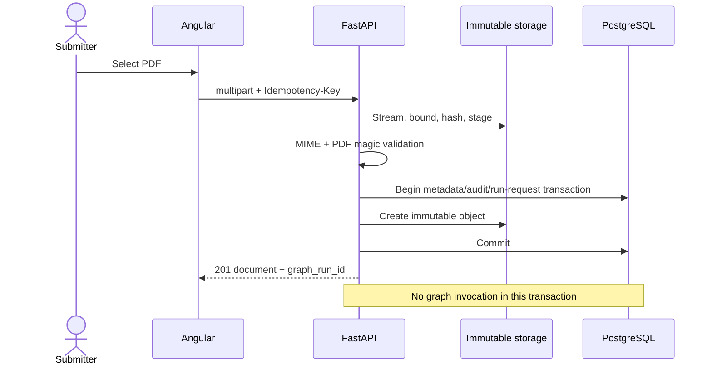
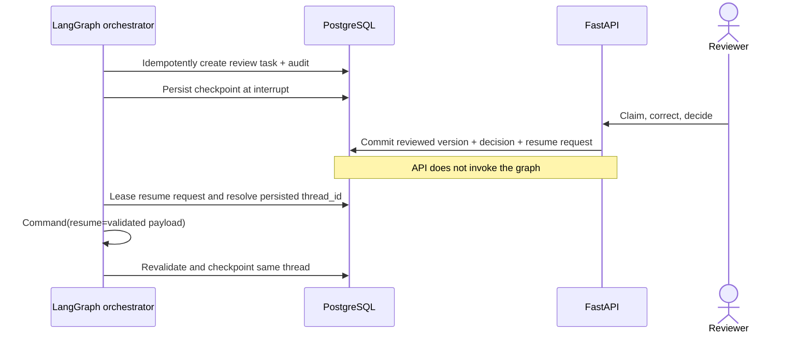
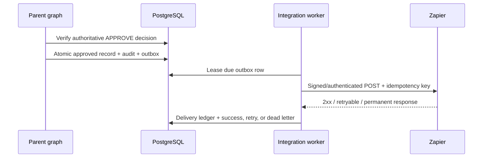

# Technical Specification

## Deployment components

Compose service names are `angular-web`, `fastapi-api`, `langgraph-orchestrator`,
`integration-worker`, `streamlit-dashboard`, `postgres`, and profile-scoped `mock-zapier`.

## Upload transaction

Storage compensation removes only an unreferenced object if database commit fails. Original objects
are never updated or overwritten.

## Human interrupt and resume

## Approval and delivery

Delivery is at least once at the HTTP boundary and exactly once at the mock/business-effect boundary
when the receiver honors the supplied idempotency key.

## Versioning and configuration

Graph, policy, prompt, extraction schema, rules, confidence, event payload, and recommendation formats
are versioned. Provider and model are server configuration. Production uses PostgreSQL checkpoints;
`InMemorySaver` is limited to narrow graph unit tests. All images and package versions are pinned.
